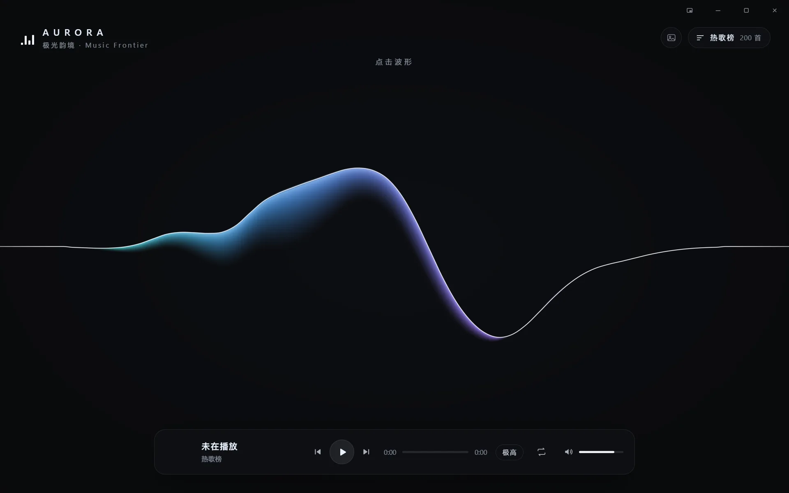

# AURORA 极光韵境

以光影动效为核心的音乐播放器：一条随音乐律动的极光波形，点击变为音柱，再点击进入立体态，音柱侧向翻出为专辑封面。
音乐来源为本地音乐 + 网易云音乐，有 Windows 桌面版和网页版。



## 下载

Windows 10 / 11（64 位）：在 [Releases](https://github.com/SakuraPure/aurora-player/releases/latest) 下载 `AURORA_<版本>_x64-setup.exe` 安装。
之后有新版本时，应用标题栏会出现"新版本 · 点击更新"，一键更新。

## 功能

**画面**

- 极光波形：由正在播放的音频频谱驱动，起伏时拖出渐变的极光光晕；还没开始播放时是一段开屏演示
- 音柱与立体态：点击波形线变为音柱，点击音柱进入立体态并弹出封面；滚轮推动音柱，可以翻阅整个歌单
- 封面背景（可开关）：当前歌曲的封面作为波形背景，极光配色取自封面；点开音柱时背景被吸收进封面，播放时再释放出来

**网易云音乐**

- 扫码登录（不经手密码），登录过期时会提示重新扫码
- 榜单、搜索单曲 / 歌单、每日推荐、私人漫游、私人雷达、推荐 / 分类 / 精品歌单、我的歌单
- 音质选择：标准 / 较高 / 极高 / 无损 / Hi-Res / 超清母带，所选档位不可用时自动降到可用的最高档
- 同步歌词，外语歌显示中文翻译

**本地音乐**

- 导入文件夹、添加文件或直接拖进窗口，读取标签与内嵌封面
- 桌面版记住添加过的文件夹，启动时自动重新扫描

**播放**

- 列表循环 / 随机 / 单曲循环，歌单内搜索，系统媒体控件与键盘媒体键

**桌面版**

- 关闭窗口隐藏到系统托盘，音乐继续；托盘菜单可以控制播放
- 迷你模式：缩成一条置顶的小播放条
- 记住窗口大小与位置
- 自动更新，更新包带签名校验
- 不在播放、窗口隐藏或最小化时停止渲染，不占用 CPU / GPU

## 操作

| 操作 | 效果 |
| --- | --- |
| 点击波形线 | 变为音柱 |
| 点击音柱 | 进入立体态，弹出封面 |
| 移动鼠标 / 滚轮 / ← → | 立体态下翻阅封面 |
| 点击封面 | 播放这首歌 |
| 点击空白处 / Esc | 返回波形 |
| 空格 | 播放 / 暂停 |
| B | 开关封面背景 |
| 右上角曲库按钮 | 登录网易云、浏览歌单、搜索、导入本地音乐 |

## 开发

需要 Node.js 20.19+ 或 22.12+；桌面版另需 Rust 和 [Tauri 的 Windows 依赖](https://tauri.app/start/prerequisites/)。

```bash
npm install
npm run dev          # 网页版，默认 http://localhost:5173
npm run tauri dev    # 桌面版
npm run build        # 构建网页版到 dist/
```

- 网页版的网易云功能由开发 / 预览服务器上的中间层提供（`npm run dev` 或 `npm run preview`）；把 `dist/` 当纯静态网站部署时没有网易云功能。
- 发布桌面版：`npm run release -- --publish`，需要更新签名私钥，见 [docs/release.md](docs/release.md)。

技术栈：Vite + TypeScript + three.js（WebGL2 全屏着色器）；桌面版 Tauri 2（Rust）。

## 文档

- [DEVLOG.md](DEVLOG.md)：开发日志，包括每个版本的改动、代码结构、踩坑记录和待办
- [docs/netease-api.md](docs/netease-api.md)：网易云接口维护文档
- [docs/release.md](docs/release.md)：桌面版发布与自动更新

## 声明

- 网易云音乐功能基于非官方接口（网页版使用 [NeteaseCloudMusicApi](https://www.npmjs.com/package/NeteaseCloudMusicApi)，桌面版为其 Rust 移植），与网易云音乐官方无关，仅供个人学习交流；接口随时可能变化。
- 登录信息只保存在本机。
- 音乐、封面、歌词的版权归各自的权利人所有。
